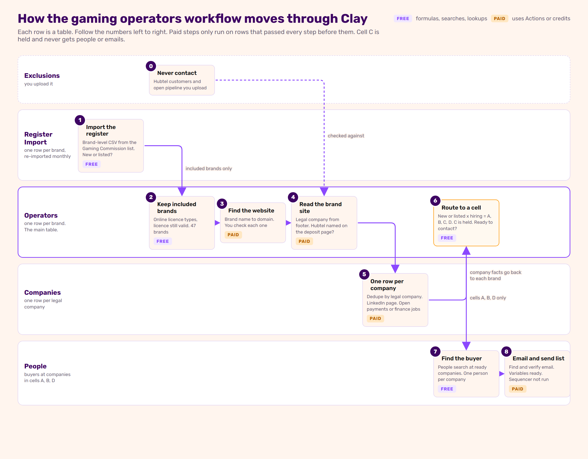

# Clay Build Guide: Licensed gaming operators in Ghana (Hubtel)

A step-by-step guide to building `workflow-spec.md` (in this folder, status STRUCTURE-APPROVED 2026-11-19) in Clay. Written for someone who has never built anything in Clay. Follow the parts in order. Each step tells you **why** it exists, **what to click**, **what to type**, **how to check it worked** and **what it costs**.

> **Don't skip the checks.** The most common Clay mistake is running a column on every row before checking it worked on one. This guide imports all 47 brands (free) but runs every paid column on a 10-brand test batch first. Do not run a paid column on the other 37 until Part 12 says so.

Nothing in this guide sends anything. Copy is not written yet (`/campaign-copy` is blocked on Hubtel approving claims), the sequencer is not chosen, and the sequencer step is described but not built.

---

## Contents

- [What you are building](#what-you-are-building)
- [Clay words you need](#clay-words-you-need)
- [Before you start](#before-you-start)
- [Part 0. Set up the workbook](#part-0-set-up-the-workbook)
- [Part 1. Exclusions table](#part-1-exclusions-table)
- [Part 2. Register Import table](#part-2-register-import-table)
- [Part 3. Operators table: keep the included brands](#part-3-operators-table-keep-the-included-brands)
- [Part 4. Find each brand's website](#part-4-find-each-brands-website)
- [Part 5. Read the brand site](#part-5-read-the-brand-site)
- [Part 6. Companies table](#part-6-companies-table)
- [Part 7. Hiring overlay](#part-7-hiring-overlay)
- [Part 8. Route each brand to a cell](#part-8-route-each-brand-to-a-cell)
- [Part 9. People table: find the buyer](#part-9-people-table-find-the-buyer)
- [Part 10. Find and verify the work email](#part-10-find-and-verify-the-work-email)
- [Part 11. Variables, views and the sequencer](#part-11-variables-views-and-the-sequencer)
- [Part 12. Review the 10-brand test, then run the other 37](#part-12-review-the-10-brand-test-then-run-the-other-37)
- [What it costs](#what-it-costs)
- [Final checklist](#final-checklist)
- [When something goes wrong](#when-something-goes-wrong)
- [Things the spec needs to fix](#things-the-spec-needs-to-fix)

---

## What you are building

The spec says: take the brands on the Gaming Commission's list of licensed operators that hold an online licence, check each is not already a Hubtel customer, work out the company behind it, see whether that company is hiring for payments or finance roles, sort each brand into one of four "cells" (new or already listed, crossed with hiring or not), find one buyer per company, and verify their email. **Cell C (already listed, not hiring) is held**: it stays in the table but never gets people or emails. Only cells A, B and D are sendable.

You will build **5 tables** inside **1 workbook**:



Each row of the picture is a table. The numbers are the order you build in. Step 0 is the list you upload first.

Why this shape:
- **Account first.** The spec's trigger is a list entry on a regulator register, so we start from companies, not people.
- **Brand checks and company checks are separate.** Several brands can belong to one legal company. Facts about the brand (website, licence) live in **Operators**. Facts about the company (LinkedIn page, hiring, buyer) live in **Companies**, once per company. This also enforces the spec rule "one conversation per company".
- **People are found last, and only for cells A, B and D.** The held cell never costs a people search or an email.
- **Everything paid runs late**, behind a run condition, and first on 10 test brands.

What a finished row in **Operators** looks like, reading left to right (values are made up to show the shape, they are not findings):

| Brand | Licence types | New or listed | Domain | Legal company | Hubtel on deposit page | Hiring | Role title | Cell | Ready to contact |
|---|---|---|---|---|---|---|---|---|---|
| ExampleBet | Sports Betting, Online Casino | listed | examplebet.com.gh | Example Gaming Ltd | clear | 1+ | Payments Operations Manager | D | Yes |

---

## Clay words you need

| Word | What it means |
|---|---|
| **Workbook** | A folder of tables for one campaign. |
| **Table** | A spreadsheet. One row per brand, company or person. |
| **Source** | Where a table's rows come from (a Clay search, a CSV, another table). |
| **Column** | One piece of information per row. Three kinds matter: **plain** (imported or typed), **formula** (Clay calculates it, free), **enrichment / action** (Clay calls a data provider, a web page or AI, usually costs). |
| **Formula** | A small calculation like a spreadsheet formula. Free. Clay has an AI helper: describe what you want in plain English and it writes the formula. |
| **Enrichment** | A column that looks something up (company size, a LinkedIn page, an email). Costs **Actions**, sometimes **Data Credits**. |
| **Lookup** | A column that reads a matching row from another table in your workbook. Free. |
| **Send table data** | A column that copies rows from this table into another table. Free. |
| **Run condition** ("Only run if") | A rule on a paid column: it only runs on rows where the rule is true. This is how you avoid paying for rows you will throw away. |
| **Auto-run** | When on, new columns run on every row by themselves. **Keep it off** while building. |
| **Actions** | Clay's main usage meter. About 1 Action per enrichment per row. Unused Actions expire monthly. |
| **Data Credits** | A second meter, used when Clay pays a data provider for you (for example email finders). |
| **View** | A saved filter on a table, like "only rows ready to send". |
| **Register** | The Gaming Commission of Ghana's public page of licensed operators. Our list of brands comes from it. |
| **Brand** | The trade name on the register (for example one name with both a sports betting and a casino row). |
| **Cell** | One of the four routing boxes A, B, C, D in spec section 5. |
| **Gate** | A yes/no check before a person is contacted (spec section 4, G1 to G5). Gates never change the message, they only allow or hold the send. |
| **Test Batch** | The 10 brands you run every paid column on first. |

---

## Before you start

Tick these off **before** the session.

- [ ] **Clay account** and workspace. Note the plan (Settings → Plans & billing) and the Actions left. You need roughly 100 Actions for the 10-brand test and roughly 350 for all 47 (see [What it costs](#what-it-costs)). These are estimates, watch the counter.
- [ ] **Email finder connections** (Settings → Connections), if you want your own provider keys. Without them Clay uses its own and charges Data Credits.
- [ ] **The spec open** next to you: `output/campaigns/gaming-operators/workflow-spec.md`. You are building sections 2, 4, 5 and 6.
- [ ] **The register file**: `context/docs/research/gaming-licensed-operators.csv` (88 rows, snapshot of 2026-11-16, kept on your computer only, not in GitHub). Part 2 turns it into the brand-level CSV.
- [ ] **A list of Hubtel customers and open deals** from Hubtel sales, for Part 1. The spec's open question 2. Without it the Exclusions table starts empty and Hubtel sales must review the final list before any send.
- [ ] **Decide the test batch.** This guide uses the 10 brands from the 2026-11-19 domain test: SPORTYBET, BETWAY, BETIKA, 1XBET, BETPAWA, KEEDBET, NUMBA, GOWIN21, PRIDESPINS, SOCCABET. We already have a rough answer for each domain, so the test also checks Clay against it. That earlier answer is a reading of search results, not ground truth.
- [ ] **Nothing is sent from this build.** Don't connect a sequencer yet.

---

## Part 0. Set up the workbook

**Why:** one place for everything in this campaign.

1. In Clay click **+ New** → **Workbook**.
2. Name it: `Hubtel · Gaming operators (register)`.
3. In the workbook description paste: *"Signal: brands on the Gaming Commission licensed-operators register, plus a hiring overlay. Spec: hubtel-gtm-context-os/output/campaigns/gaming-operators/workflow-spec.md. Only cells A, B and D send. Cell C is held."*

**Check:** the workbook appears in your Clay home with that name.
**Cost:** free.

---

## Part 1. Exclusions table

**Why:** spec section 2 excludes existing Hubtel customers and open pipeline. One table lets every other table check against it. Hubtel's own gaming case study is anonymous, so we cannot name the customer ourselves: the names must come from Hubtel.

### 1.1 Make the CSV

Create `exclusions.csv` with 3 columns:

| Company Name | Domain | Type |
|---|---|---|
| (from Hubtel sales) | | Customer |
| (from Hubtel sales) | | Open pipeline |

Leave the sample rows out of the real file. Fill the **Domain** for every row, written plain: `example.com`. No `https://`, no `www.`, no slash at the end. Check each on the company's own website. Leave a domain blank if you are not sure, never guess. A blank domain cannot match, so a row without a domain protects nobody: chase it.

> **Why domain and not name:** names clash and vary. A domain belongs to one company. All lookups in this build match on domain.

> Rows will also be added later by Part 5, when a deposit page names Hubtel.

### 1.2 Upload it

1. Inside the workbook click **+ Add table** → **Import CSV**.
2. Upload `exclusions.csv`. Name the table `Exclusions`.

**Check:** the row count equals the number of lines Hubtel sent, 3 columns.
**Cost:** free.

---

## Part 2. Register Import table

**Why:** the spec's signal S2 (new or listed) needs a history. Each month you import the new register snapshot into this table and compare it with brands already seen. The first import (2026-11-16) is the baseline: every brand in it counts as `listed`.

### 2.1 Make the brand-level CSV (once, outside Clay)

The register has one row per licence, so a brand with two licences appears twice (1XBET has sports betting and online casino). Collapse it to **one row per brand** in a spreadsheet (pivot or `TEXTJOIN`) and save `register-2026-11-16.csv` with these columns:

| Column | What goes in it |
|---|---|
| `Brand` | `operator_trade_name` as printed on the register |
| `Licence Types` | every licence type of that brand, joined with ` | ` |
| `Licence Type Count` | how many different types |
| `End Date` | latest end date, written `YYYY-MM-DD` (the register prints day/month/year, convert it) |
| `Snapshot Date` | `2026-11-16` |
| `Source URL` | `https://www.gamingcommission.gov.gh/licensed-operators` |

Expected result: **68 named brands** (the register has 69 trade-name groups, one of which is the 3 rows with a blank name). **Leave the 3 blank-name rows out of the CSV** and write them down as a hold list for later: no name means no account (spec section 2).

### 2.2 Import it

1. **+ Add table** → **Import CSV** → upload `register-2026-11-16.csv`. Name the table `Register Import`.
2. **Turn Auto-run OFF** (table menu ⚙ or "…" → Auto-update or Auto-run).
3. Add a formula column `Brand Key`:
   - **Plain English:** *"The Brand in capital letters, with spaces at the ends removed."*
   - **Formula:**
   ```javascript
   ({{Brand}} || "").trim().toUpperCase()
   ```
4. Table settings → **Deduplicate** → `Brand Key`.

**Check:** 68 rows. Open 1XBET and confirm both licence types show in `Licence Types`.
**Cost:** free.

### 2.3 Flag new brands against history (formula, free)

You do this after Part 3 creates Operators, because it looks brands up there. For the first import everything is `listed`. Leave a note here: *"Part 3.4 adds the New or Listed column."*

---

## Part 3. Operators table: keep the included brands

**Why:** spec section 2 includes brands with an online licence type and a valid licence, and excludes land-based casinos, bingo, scratch cards and "Route" licences. We express that as formulas so it is visible and reusable every month.

### 3.1 Add the licence gates to Register Import (formulas, free)

| Column | Plain English | Formula |
|---|---|---|
| `Included Licence?` | True if the licence types include sports betting, online casino or remote interactive games. A land-based "Casino", "Bingo", "Scratch Card" or "Route" alone does not count | `/sports betting\|online casino\|remote interactive games/i.test({{Licence Types}} \|\| "")` |
| `Licence Valid?` | True if the End Date is today or later | `{{End Date}} ? new Date({{End Date}}) >= new Date() : false` |
| `Keep?` | True if both are true | `{{Included Licence?}} === true && {{Licence Valid?}} === true` |

**Check:** filter `Keep?` = true. Expect **47 rows** (the spec's count, from the register snapshot). If the count differs, the register changed or the regex needs a fix. Spot check: WALDO CASINO must be false, 1XBET true, BINGO AFRICA false.

### 3.2 Create the Operators table

1. **+ Add table** → **Blank table**. Name it `Operators`. **Auto-run OFF.**
2. Add plain columns: `Brand`, `Brand Key`, `Licence Types`, `Licence Type Count`, `End Date`, `First Seen`.
3. Table settings → **Deduplicate** → `Brand Key`.

### 3.3 Send the kept brands over

In `Register Import`:

1. **+ Add column** → **Send table data**.
2. Destination: `Operators`. Map `Brand`, `Brand Key`, `Licence Types`, `Licence Type Count`, `End Date`. Map `First Seen` to `{{Snapshot Date}}`.
3. **Run condition:** `{{Keep?}} === true`
4. Run on **1 row**, open Operators and check it arrived. Then run on all rows.

**Check:** Operators has **47 rows**, no duplicates.
**Cost:** free.

### 3.4 New or listed, and the product mix (formulas, free)

In `Operators`:

| Column | Plain English | Formula |
|---|---|---|
| `Days Since First Seen` | Whole days from First Seen to today | `Math.floor((new Date() - new Date({{First Seen}})) / 86400000)` |
| `New or Listed` | `new` if First Seen is after the baseline 2026-11-16 and within 90 days, else `listed`. The 90 days is a proposal, see [Things the spec needs to fix](#things-the-spec-needs-to-fix) | `{{First Seen}} > "2026-11-16" && {{Days Since First Seen}} <= 90 ? "new" : "listed"` |
| `Licence Summary` | One plain phrase for the licences: "sports betting and casino" if it has both, "sports betting", "online casino", or "remote games". Used as `{{licence_summary}}` | `(/sports betting/i.test({{Licence Types}}) && /casino/i.test({{Licence Types}})) ? "sports betting and casino" : /sports betting/i.test({{Licence Types}}) ? "sports betting" : /casino/i.test({{Licence Types}}) ? "online casino" : "remote games"` |
| `Product Mix` | `several` if more than one licence type, else `one` | `{{Licence Type Count}} > 1 ? "several" : "one"` |

**Check:** on the first import every row says `listed`. 1XBET shows "sports betting and casino". Next month, a brand imported with a new Snapshot Date shows `new`.
**Cost:** free.

**Monthly re-import:** save the next register as `register-YYYY-MM-DD.csv`, import it into `Register Import` (a new table or append, as Clay allows), run Part 3.3 again. Dedupe keeps old brands unchanged (their `First Seen` stays the old date) and adds new brands with the new date. Do one extra read in the first week of January 2027 for the renewal wave.

---

## Part 4. Find each brand's website

**Why:** every later step needs the brand's own domain (spec gate G2, and all lookups key on domain). The register has no domains. In our 10-brand test, 8 were clear, 1 probable (KEEDBET) and 1 uncertain (GOWIN21), so this step needs a human check.

### 4.1 Add the test flag

In `Operators` add a **checkbox** column `Test Batch?` and tick it for the 10 brands: SPORTYBET, BETWAY, BETIKA, 1XBET, BETPAWA, KEEDBET, NUMBA, GOWIN21, PRIDESPINS, SOCCABET. Then create a **view** called `Test 10`, filtered to `Test Batch?` checked. Run every paid column through this view until Part 12.

### 4.2 Find the domain

1. **+ Add column** → search for the enrichment that finds a company website from a name (likely named **Find company domain**, **Company name to domain** or **Enrich Company from name**). Input: `{{Brand}}`, plus "Ghana" as extra context if the action allows it.
2. **Run condition:** `{{Test Batch?}} === true` (change this in Part 12 after the review).
3. Run on **1 row** (BETWAY). Read what came back.
4. If the action returns a domain, add it as a column `Domain Found`.

**Fallback if the native action returns nothing or the wrong site:** add a **Claygent** column `Domain (Claygent)`:
> *Find the official website of the Ghana-licensed online betting or gaming operator named {{Brand}}. Prefer the Ghana site (for example a .com.gh address or a /gh page). Do not use affiliate, review or look-alike sites, and do not use app store pages. Return the plain domain with no https:// and no www.*

Output **JSON**: `domain` (text), `evidence` (text: the page title or footer that shows the brand name), `confidence` (one of `high`, `medium`, `low`). **Run condition:** `{{Test Batch?}} === true && !{{Domain Found}}`. Run on 2 or 3 rows you can judge.

### 4.3 Clean it and check it (formulas, free, and one human column)

| Column | Plain English | Formula |
|---|---|---|
| `Domain` | The domain in lowercase with no https://, no www. and no slash | `(({{Domain Found}} \|\| {{Domain (Claygent)}} \|\| "") + "").toLowerCase().replace(/^https?:\/\//, "").replace(/^www\./, "").replace(/\/.*$/, "")` |
| `Domain Present?` | True if a domain exists | `{{Domain}}.length > 0` |

Add a **single select** column `Domain OK?` with options `yes`, `no`, `unsure` and **fill it by hand**. Open each domain. Say `yes` only if the site names the brand and is the operator's own site, not an affiliate or a copy. This is spec gate **G2**. It is 47 rows, so a human check is cheap and more reliable than a formula.

> **Answer key from the 2026-11-19 test** (a reading of search results, not proof): SPORTYBET sportybet.com, BETWAY betway.com.gh, BETIKA betika.com.gh, 1XBET 1xbet.com.gh, BETPAWA betpawa.com.gh, NUMBA numba.app, PRIDESPINS pridespins.com.gh, SOCCABET soccabet.com, KEEDBET keedbet.com (probable), GOWIN21 gowin21.com (uncertain). Use it to check what Clay returned. If Clay disagrees, open both and decide.

**Check:** write down for the test batch how many are `yes`, `no`, `unsure`. This is the first number Part 12 needs.
**Cost:** about 1 Action per row for the native action, plus Actions and AI cost if you use Claygent. Watch the counter.

---

## Part 5. Read the brand site

**Why:** two spec reads need the text of the brand's own pages. S4 reads the legal company from the footer or terms. G1 checks the deposit page for the word "hubtel" so we can exclude existing customers. Both are regex checks on page text, so they stay deterministic. The page text itself comes from a scraping action.

### 5.1 Get the page text

1. **+ Add column** → search for **Scrape website** (may be called **Scrape page**, **Get page content** or **HTTP API**).
2. Make two columns:
   - `Terms Page Text`: input the domain's terms or footer page. Use `https://{{Domain}}/terms` first. If you cannot build a rule for the right URL, scrape the home page, which usually carries the footer, and note it.
   - `Deposit Page Text`: input the deposit or payments page. Most betting sites keep deposits behind a login, so expect many blanks.
3. **Run condition for both:** `{{Test Batch?}} === true && {{Domain OK?}} === "yes"`
4. Run on **1 row**. Read the text that came back.

**Fallback for pages that need JavaScript or return nothing:** a **Claygent** column that visits the site and returns the page text or the footer line. It costs more, so use it only on rows where the scrape came back empty.

### 5.2 Legal company (S4) and Hubtel check (G1), formulas, free

| Column | Plain English | Formula |
|---|---|---|
| `Legal Company` | The company name ending in Ltd, Limited, Company or Inc that follows "operated by", "owned by", "licensed to" or "a company registered", from the terms or footer text. Blank if none | `(/(?:operated by\|owned by\|licensed to\|a company registered(?: as\| in [A-Za-z ]+)?)\s+([A-Z][A-Za-z0-9&.,'() -]{2,80}?\s(?:Ltd\|Limited\|Company\|Inc)\b\.?)/.exec({{Terms Page Text}} \|\| "") \|\| [])[1] \|\| ""` |
| `Deposit Text Read?` | True if the deposit page text has more than 200 characters, so we can trust "not found" | `({{Deposit Page Text}} \|\| "").length > 200` |
| `Hubtel Check (G1)` | `customer` if the deposit text mentions Hubtel, `clear` if it was read and does not, `unknown` if it could not be read | `!{{Deposit Text Read?}} ? "unknown" : (/hubtel/i.test({{Deposit Page Text}}) ? "customer" : "clear")` |
| `Exclusion Match` | Lookup in `Exclusions` by domain | (lookup, see below) |

**Add `Exclusion Match`:** **+ Add column** → **Lookup single row in other table**. Table `Exclusions`, match column `Domain`, value `{{Domain}}`. Run on all rows (free).

**Important:** `unknown` is not a pass. Spec section 2 relies on Hubtel sales reviewing the list, so `unknown` goes to review. A brand named in a deposit page as a customer should be **added to `Exclusions`** (domain plus type `Customer detected`) so it is never contacted from any other table.

**Check:** on the test batch, write down how many `Legal Company` values came back non-empty (spec S4) and how many `Hubtel Check` values are `clear`, `customer` and `unknown`. Read three legal names against the site by eye. A wrong name here would merge two brands, so do not skip this.
**Cost:** about 1 Action per scrape (two per brand), more if Claygent runs. Watch the counter.

---

## Part 6. Companies table

**Why:** several brands can share one legal company, and the spec sends one conversation per company (section 7). Company-level work (LinkedIn page, hiring, people) happens once per company.

### 6.1 Create the table

1. **+ Add table** → **Blank table**. Name it `Companies`. **Auto-run OFF.**
2. Plain columns: `Company Key`, `Primary Brand Domain`, `Company Name`.
3. Table settings → **Deduplicate** → `Company Key`.

> **The one exception to "key on domain":** two brands of one company have different domains, so the company key here is the legal company name. When `Legal Company` is empty the key falls back to the brand name, so an unreadable brand is never merged by accident.

### 6.2 Send each company over

In `Operators` add a formula `Company Key`:
- **Plain English:** *"The legal company in capital letters if there is one, otherwise the brand name in capital letters."*
- **Formula:**
```javascript
(({{Legal Company}} || {{Brand}}) + "").trim().toUpperCase()
```

Then **+ Add column** → **Send table data**:
1. Destination `Companies`. Map `Company Key` → `{{Company Key}}`, `Primary Brand Domain` → `{{Domain}}`, `Company Name` → `{{Legal Company}}` (or brand).
2. **Run condition:** `{{Domain OK?}} === "yes" && {{Hubtel Check (G1)}} !== "customer" && !{{Exclusion Match}} && ({{New or Listed}} === "new" || {{New or Listed}} === "listed")` and `{{Test Batch?}} === true` during the test.
3. Run on **1 row**, check the arrival, then run on the rest of the test batch.

**Check:** Companies has the same number of rows as distinct legal companies in your test batch (so equal to or fewer than the brand count). No duplicates.
**Cost:** free.

### 6.3 LinkedIn page and company enrichment

1. **+ Add column** → **Enrich Company**. Input the primary brand `{{Primary Brand Domain}}`, or the LinkedIn company URL if the action takes it.
2. **Run condition:** `{{Primary Brand Domain}}` is not empty. Run on **1 row** first and read the LinkedIn URL, headcount and description it returns.
3. **Add as column:** `LinkedIn Company URL` (type **URL**), `Employees`, `HQ Country`, `Description`.

**Check:** open 2 LinkedIn pages and confirm they are the operator, not a similarly named company. The name-to-page match is not tested yet, so this is the first real test of it.
**Cost:** about 1 Action per company.

---

## Part 7. Hiring overlay

**Why:** spec signal S3. A payments or finance role open in the last 30 days moves a brand to the "hiring" side of the matrix (cells B and D). It runs weekly. The earlier hiring sample found 0 ICP postings in 13, and description text is not returned, so only job **titles** are read.

1. In `Companies` **+ Add column** → search **Find jobs at company** (may be called **Company job postings**). Input `{{LinkedIn Company URL}}`.
2. **Run condition:** `{{LinkedIn Company URL}}` is not empty. Run on **1 row**, open the cell, and note the field names for title, posted date and link.
3. **Add as column:** `Jobs` (the list).

### Formulas (free)

| Column | Plain English | Formula |
|---|---|---|
| `Matching Jobs` | The jobs posted in the last 30 days whose title mentions payment, collections, treasury, reconciliation, mobile money, digital channels, finance manager, head of finance, fintech or billing. Field names may differ in your Jobs data | `({{Jobs}} \|\| []).filter(function (j) { return /payment\|collections?\|treasury\|reconciliation\|mobile money\|digital channels?\|finance manager\|head of finance\|fintech\|billing/i.test(j.title \|\| "") && (new Date() - new Date(j.posted_at \|\| j.date \|\| 0)) / 86400000 <= 30; })` |
| `Hiring Count` | Number of matching jobs | `({{Matching Jobs}} \|\| []).length` |
| `Hiring Cluster` | `1+` if at least one, else `0` (spec cluster) | `{{Hiring Count}} >= 1 ? "1+" : "0"` |
| `Role Title` | Title of the most recent matching job | `({{Matching Jobs}} \|\| []).length ? {{Matching Jobs}}[0].title : ""` |
| `Job Post URL` | Link of that job | `({{Matching Jobs}} \|\| []).length ? ({{Matching Jobs}}[0].url \|\| "") : ""` |

**Check:** pick one company and open its jobs on LinkedIn. Does the count match? Write down for the test batch how many companies have `Hiring Cluster` = `1+`. Expect few.
**Cost:** about 1 Action per company per run. The run is weekly: re-run this column by hand each week on the live companies (Clay may let you schedule it, check the table menu). Do not turn Auto-run on for it.

---

## Part 8. Route each brand to a cell

**Why:** spec section 5. Four cells from two axes. A and B are `new`, C and D are `listed`. B and D are hiring. **C is held.**

### 8.1 Read company facts back to each brand (lookups, free)

In `Operators` add **Lookup single row in other table** columns on `Companies`, matching `Company Key`:
`Hiring Cluster`, `Role Title`, `Job Post URL`, `LinkedIn Company URL`, `Primary Brand Domain`. Name them the same, with the prefix `Co `, for example `Co Hiring Cluster`.

> Only formula columns carry cleanly across a lookup, which is why the hiring values in Part 7 are formulas.

### 8.2 `Cell`, `Cell Status`, `Primary Brand?`, `Ready to Contact?` (formulas, free)

#### `Cell`: routes on `New or Listed` and `Co Hiring Cluster`

- **Plain English:** *"A if the brand is new and the company has no matching job. B if new and 1 or more. C if listed and none. D if listed and 1 or more. Blank if the hiring value is missing."*
- **Formula:**
```javascript
!{{Co Hiring Cluster}} ? "" : ({{New or Listed}} === "new" ? ({{Co Hiring Cluster}} === "1+" ? "B" : "A") : ({{Co Hiring Cluster}} === "1+" ? "D" : "C"))
```
- **Check:** on the first import every brand is `listed`, so cells are only C or D. D appears only where a hiring job was found.

#### `Cell Status`: C is held

- **Plain English:** *"Sendable for A, B and D. Held for C. Blank otherwise."*
- **Formula:**
```javascript
["A","B","D"].includes({{Cell}}) ? "sendable" : ({{Cell}} === "C" ? "held" : "")
```

#### `Primary Brand?`: one brand per company

- **Plain English:** *"True if this brand's domain is the primary brand domain of its company."*
- **Formula:**
```javascript
{{Domain}} === {{Co Primary Brand Domain}}
```

#### `Ready to Contact?`: the gates

- **Plain English:** *"True only if the cell is sendable, the licence is valid, the domain was checked as yes, Hubtel check is clear, there is no exclusion match, and this is the company's primary brand."*
- **Formula:**
```javascript
{{Cell Status}} === "sendable" && {{Licence Valid?}} === true && {{Domain OK?}} === "yes" && {{Hubtel Check (G1)}} === "clear" && !{{Exclusion Match}} && {{Primary Brand?}} === true
```
- **Check:** every held (C) row and every `unknown` row has `Ready to Contact?` = false. Sort and open five false rows to confirm each deserves it. If a good row is false, fix the formula, not the row.

**Cost:** free.

---

## Part 9. People table: find the buyer

**Why:** the spec recipient is one person per company, in this order: Head of Payments, Finance Manager or CFO, Country Manager. Titles are INFERRED and not yet confirmed. Only companies in sendable cells get a people search, so the held cell never costs anything here.

### 9.1 Create a view of ready companies

In `Companies` add a formula column `Sendable?` by looking up `Operators` on the primary brand domain for `Ready to Contact?`. Then create a **view** `Ready Companies` filtered to `Sendable?` = true.

### 9.2 Start the people search from that view

1. **+ Add table** → **Find people**, and choose **From a table** → `Companies` → view `Ready Companies`. Do not paste domains. A pasted list does not update when more companies qualify.
2. Filters:

| Filter | Set it to | Why |
|---|---|---|
| **Job title: include** | Head of Payments · Payments Manager · Payments Lead · Head of Finance · Finance Manager · Chief Financial Officer · CFO · Country Manager · General Manager | Spec gate G4 titles. INFERRED, to be confirmed |
| **Job title: exclude** | Assistant · Intern · Junior | Junior roles |
| **Company size** | leave empty | The spec has no size filter (open question) |
| **Person country** | leave empty for the first run | Spec is silent, see [Things the spec needs to fix](#things-the-spec-needs-to-fix). A payments head of a pan-African operator may not sit in Ghana |

3. **Check the numbers before importing:** look at the free preview count. Write it down. Then add Ghana as person country and write that count down.
4. Import with a **limit** of the test batch size. Name the table `People`. **Auto-run OFF.** Table settings → **Deduplicate** → `LinkedIn Profile`.
5. Open one cell, find the company domain and **Add as column** `Company Domain`. Add `Person Country` the same way if available.

### 9.3 Pick one person per company (formulas and lookups, free)

| Column | Plain English | Formula |
|---|---|---|
| `Title Rank` | 1 for Head of Payments or payments manager or lead, 2 for finance manager, head of finance, CFO or Chief Financial Officer, 3 for Country Manager or General Manager, else 9 | `/payments? (lead\|manager)\|head of payments/i.test({{Job Title}}) ? 1 : /finance manager\|head of finance\|chief financial\|\bcfo\b/i.test({{Job Title}}) ? 2 : /country manager\|general manager/i.test({{Job Title}}) ? 3 : 9` |

In `Companies` add **Lookup multiple rows in other table** on `People` matching `Company Domain`, returning `Title Rank` and `LinkedIn Profile`, then a formula `Chosen Contact` that returns the profile with the lowest rank (ties go to the first). Look it back up in `People` and add:

- `Is Recipient?` formula: `{{LinkedIn Profile}} === {{Chosen Contact}}`

If Clay's lookup cannot return a sorted list, make a **view** on `People` sorted by `Title Rank` ascending and keep one row per company by hand. With this few companies, that is fine.

**Check:** each ready company has exactly one `Is Recipient?` = true. Open 3 LinkedIn profiles and confirm title and company. G4 passes only if a recipient exists.
**Cost:** the search is free. The lookups and formulas are free.

---

## Part 10. Find and verify the work email

**Why:** gate G5. Ghana email coverage is untested. The 10-row test tells you the real hit rate before you pay for the rest.

1. In `People` **+ Add column** → **Find work email** (the native waterfall). Own-key providers first if you connected them, about 4 steps, validation on, strict (no catch-all, no risky).
2. **Run condition:** `{{Is Recipient?}} === true`
3. Run on **1 row**, read the cell, then run on the rest of the recipients.
4. Add a formula `Email Domain OK?`:
   - **Plain English:** *"True if the email's domain is the company domain."*
   - **Formula:** `({{Work Email}} || "").split("@")[1] === {{Company Domain}}`
5. Add `Ready to Send?`:
   - **Plain English:** *"True only if this person is the recipient, the email is verified and the email domain matches."*
   - **Formula:** `{{Is Recipient?}} === true && {{Email Status}} === "valid" && {{Email Domain OK?}} === true`

Rows where the email domain differs from the company domain go to a review view. Company-level checks did not cover them.

**Check:** write down for the test batch how many recipients got a verified email. If the hit rate is low, stop and tell the team before running more.
**Cost:** Actions plus Data Credits for each provider step that actually runs. Watch both counters.

---

## Part 11. Variables, views and the sequencer

**Why:** spec section 6 lists every variable copy may use. Copy is **not written** and **no claim is approved**, so we do not build copy formulas now. We build the variables so `/campaign-copy` and the sequencer can use them later.

### 11.1 Variable columns (formulas, free) in `People`

Pull the Operator facts into People by domain with lookups, then add:

| Spec variable | Column in People | Source |
|---|---|---|
| `{{first_name}}` | `first_name` | first word of the person's name, first letter capital |
| `{{company_name}}` | `company_name` | brand name from the register, title case |
| `{{legal_company}}` | `legal_company` | `Legal Company` (may be empty) |
| `{{licence_summary}}` | `licence_summary` | `Licence Summary` |
| `{{first_seen_date}}` | `first_seen_date` | `First Seen` as `YYYY-MM`, in cells A and B only |
| `{{role_title}}` | `role_title` | `Role Title`, in cells B and D only |
| `{{job_post_url}}` | `job_post_url` | `Job Post URL`, in cells B and D only |
| `{{sender_name}}`, `{{sender_title}}` | not built | Not found: Hubtel has not named a sender |

`first_name` formula: *"The person's first name with a capital first letter."*
```javascript
(function (n) { n = ({{Full Name}} || "").trim().split(" ")[0] || ""; return n.charAt(0).toUpperCase() + n.slice(1).toLowerCase(); })()
```

Empty field means the line that uses it is dropped. Nothing is filled from memory.

### 11.2 Views for the operator

| View | On table | Filter | Use |
|---|---|---|---|
| `Test 10` | Operators | `Test Batch?` checked | Run scope until Part 12 |
| `Held (cell C)` | Operators | `Cell Status` = held | Held accounts, kept visible |
| `Needs Hubtel review` | Operators | `Hubtel Check (G1)` = unknown or customer | Hubtel sales reviews before any send |
| `Domain check` | Operators | `Domain OK?` empty, no or unsure | Fix first |
| `Ready companies` | Companies | `Sendable?` true | Feeds people search |
| `Recipients` | People | `Is Recipient?` true | The people we would contact |
| `Send list` | People | `Ready to Send?` true | What would go to a sequencer |

### 11.3 The sequencer (do not build or run)

Spec section 7: email first, then LinkedIn, about 14 days, under 10 new accounts a week, 90-day suppression, and a human approving each first email. **The sequencer is not chosen, so there is nothing to connect.** When one is chosen, push only the `Send list` view with the variable columns above and run it only after Hubtel approves at least one claim and names a sender in `facts.md`. Pushing a lead costs 1 Action per lead.

**Cost:** free until a push.

---

## Part 12. Review the 10-brand test, then run the other 37

**Why:** every paid step above was run on the 10-brand `Test 10` view only. Record the results here, decide, then open it up.

### 12.1 Write down these numbers

| Measure | Result (10 brands) | Good enough to continue? |
|---|---|---|
| Domains marked `yes` | ___ / 10 | |
| Domains `no` or `unsure` | ___ | |
| Legal company read | ___ / 10 | |
| Deposit page readable (`Hubtel Check` not `unknown`) | ___ / 10 | |
| Brands named as Hubtel customers | ___ | |
| LinkedIn company pages matched | ___ / (companies) | |
| Companies with `Hiring Cluster` = `1+` | ___ | |
| Recipients found | ___ / (ready companies) | |
| Verified emails | ___ / recipients | |
| Actions used | ___ | |

There is no threshold in the spec. Decide with the team what hit rate you accept, and write it here: ___.

### 12.2 Open the rest

1. Edit each paid column's run condition and delete the `{{Test Batch?}} === true` part.
2. Run each paid column on the remaining 37 brands in order: Part 4, Part 5, Part 6, Part 7, then Part 9 and Part 10.
3. Re-check the views `Domain check` and `Needs Hubtel review`.

**Check:** the 47 brands are all accounted for in one of: ready, held, needs review, domain check, excluded. Nothing is sitting in an unknown state.

---

## What it costs

Clay costs are shown as Actions and Data Credits. These are rough counts from the rules in `references/clay-rules.md`. They are not quotes. **Watch the counters** and write down the real spend after the test.

| Step | Runs on | Rough cost |
|---|---|---|
| Part 2 and 3 formulas, sends, lookups | all 68 or 47 rows | free |
| Part 4 find the domain | 10 test, then 47 brands | about 1 Action per row (more if Claygent runs) |
| Part 5 scrape terms and deposit pages | brands with a verified domain, two scrapes each | about 1 Action per scrape (more if Claygent runs) |
| Part 6 enrich company | each legal company | about 1 Action per company |
| Part 7 jobs per company | each legal company, weekly | about 1 Action per company per run |
| Part 9 people search | ready companies | free |
| Part 10 find and verify email | recipients | Actions plus Data Credits per provider step that runs |
| Sequencer push (later) | each lead | 1 Action per lead |

**Worked example for the 10-brand test** (assume all 10 reach each step; real numbers will be lower after gates):
- domain 10 + scrapes 20 + company enrich up to 10 + jobs up to 10 = about 50 Actions before any email.
- Add emails for the recipients you find (for example 4) at Actions plus Data Credits each.
- Allow roughly 70 to 100 Actions for the test including retries. If Claygent runs, it costs more.

For all 47 brands, multiply the first block by about 4.7, and expect fewer paid rows after the gates (invalid domain, Hubtel check, cell C). Honest range: about 250 to 450 Actions. Write the real number down after Part 12.

Searches, imports, formulas, lookups and views are free.

---

## Final checklist

- [ ] **Auto-run is OFF** on all 5 tables.
- [ ] Every paid column has a **run condition**.
- [ ] Every paid column was proven on **1 row** and then on the Test 10 view.
- [ ] Exclusions has domains for every row and every lookup matches on **domain**.
- [ ] Operators has **47 rows**, no duplicates, and the blank-name rows are on a hold list, not in the table.
- [ ] `Domain OK?` was filled by hand for every brand.
- [ ] `Hubtel Check` `unknown` and `customer` rows are in the `Needs Hubtel review` view and are **not** ready.
- [ ] **Cell C rows are held**: `Cell Status` = held and `Ready to Contact?` = false.
- [ ] Each ready company has exactly one recipient.
- [ ] `Ready to Send?` needs a valid email on the company's domain.
- [ ] No copy formulas and no claim in any column (none are approved).
- [ ] **No sequencer is connected.** Nothing was sent.
- [ ] The real Actions and Data Credits spend is written down in Part 12.

---

## When something goes wrong

| What you see | Likely cause | Fix |
|---|---|---|
| `Keep?` count is not 47 | The register changed, or the date format is wrong | Re-read the register, check `End Date` is `YYYY-MM-DD` |
| Domain is an affiliate or a clone site | Google-style results mix in look-alikes (1XBET showed several) | Set `Domain OK?` to no. Use the Claygent fallback with the do-not-use rule |
| Domain blank for an app-first brand | Brand lives in app stores (NUMBA is mostly an app) | Search by hand, accept the app's website, mark yes |
| `Terms Page Text` empty | Page needs JavaScript or the URL is wrong | Try the home page, or the Claygent fallback |
| `Legal Company` empty | No "operated by" wording in the text | Leave empty. The key falls back to the brand name |
| Every `Hubtel Check` is `unknown` | Deposit pages are behind a login | Expected for many sites. Send the list to Hubtel sales for review |
| `Hiring Count` is always 0 | No matching titles, or field names differ in `Jobs` | Open the Jobs cell, fix the field names in `Matching Jobs` |
| Two brands of one company both become ready | `Primary Brand?` lookup failed | Check `Company Key` is identical on both rows |
| No recipient for a ready company | Titles not found | Hold. Spec gate G4. Check the title list with Hubtel |
| Email found at a different domain | Provider returned a personal or old email | Keep in the review view. Do not send |
| Brand shows `new` right after import | `First Seen` is later than 2026-11-16 | Correct if it is really a new brand. If it is a re-import, check the Snapshot Date |

---

## Things the spec needs to fix

1. **Section 4, S2: no "new" window.** The spec says `new` means not in any earlier snapshot, so a brand would stay `new` forever. This guide uses 90 days as a PROPOSAL. Spec should state the window.
2. **Section 4, G1: unreadable deposit page.** The spec says G1 is true when "hubtel" is absent. If the page cannot be read, absence proves nothing. This guide treats `unknown` as a hold for Hubtel sales review. Spec should say so.
3. **Section 4, G4: person location.** Not specified. A payments head of a pan-African operator may sit outside Ghana. Spec should say whether to filter on country.
4. **Section 2: size.** There is no size filter ("scale-ready" has no number), so company enrichment cannot filter on size.
5. **Section 2: one company, many brands.** The spec dedupes by `{{legal_company}}`. Two brand domains share one company, so the company key here is the legal name, not the domain (the one exception to the domain-key rule). Spec should confirm.
6. **Section 3, source A: the 3 blank-name rows** need a way to be named (a re-read of the register or a manual lookup) or they stay out for good.
7. **Section 7: sequencer and sender.** Not chosen, so the sequencer step is not built. `facts.md` has no sender or approved claim.
8. **Section 6: `{{first_seen_date}}`** is the date of the first snapshot, not the licence issue date. Copy must say it that way.
